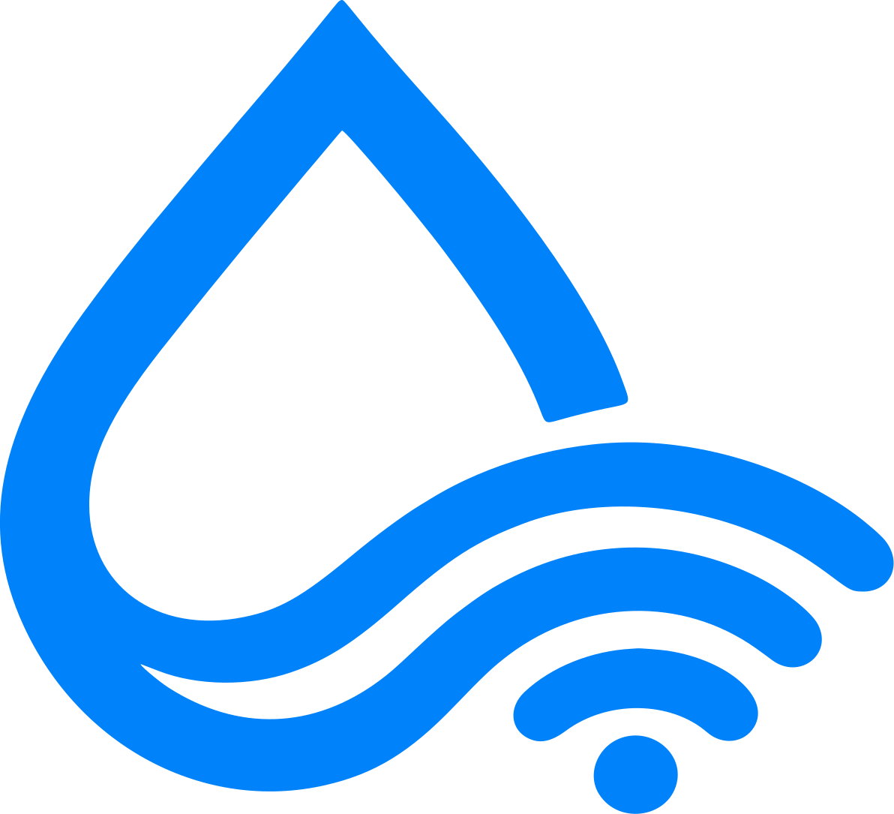

  

# RapiDrop

Copy on Mac, paste on Android. Share files over local Wi-Fi without cloud servers.

RapiDrop links your devices directly across your local network. Your data stays on your personal devices: zero cloud servers, zero accounts, zero analytics, and zero external relays.

## What It Does

* **Instant Clipboard Sync**: Copy text, links, or images on one device and paste them on the other in real time.
* **Direct File Transfer**: Send large files, videos, and documents directly between devices at local network speeds.
* **Works Offline**: Operates over your local wireless network without requiring internet access or cloud servers.
* **End to End Encrypted**: Transfers stay private and encrypted directly between your devices.
* **Protects Passwords**: Automatically ignores copied passwords from 1Password, Bitwarden, KeePass, and Apple Keychain.
* **Tap to Pair**: Discover nearby devices on screen and verify a matching 6 digit PIN to establish trust.

## Downloads

| Platform | Download |
| :--- | :--- |
| **macOS** | [`RapiDrop-macOS.dmg`](https://github.com/Prabotics/RapiDrop/releases/latest/download/RapiDrop-macOS.dmg) |
| **Android** | [`RapiDrop.apk`](https://github.com/Prabotics/RapiDrop/releases/latest/download/RapiDrop.apk) |

## Documentation

### User Guides
* [Getting Started](docs/user/getting-started.md): Installation and setup walkthrough.
* [Pairing Devices](docs/user/pairing-devices.md): Device discovery and PIN verification.
* [Clipboard Synchronization](docs/user/clipboard-sync.md): How copy and paste works.
* [Sharing Files](docs/user/sharing-files.md): File transfers and download folders.
* [Privacy & Security FAQ](docs/user/privacy-and-security.md): How your data stays private.
* [Troubleshooting](docs/user/troubleshooting.md): Local connection diagnostics.

### Developer Guides
* [Architecture Overview](docs/developer/architecture.md): Subsystems and data flow.
* [Wire Protocol Specification](docs/developer/protocol.md): Packet format and frame types.
* [Cryptographic Specification](docs/developer/security.md): Key agreement, encryption, and test vectors.
* [Testing Guide](docs/developer/testing.md): Automated tests and verification.
* [Platform Implementations](docs/developer/platforms.md): Native Swift and Kotlin architectures.
* [Operations & CI/CD](docs/developer/operations.md): Packaging, workflows, and release builds.
* [Contributing Guidelines](CONTRIBUTING.md): Code standards and pull requests.

## Building from Source

| Platform | Test | Build |
| :--- | :--- | :--- |
| **macOS** | `swift test --package-path macos` | `./macos/package.sh --all` |
| **Android** | `cd android && ./gradlew test` | `cd android && ./gradlew assembleRelease` |

## License

RapiDrop is open source software licensed under the [MIT License](LICENSE).  
Built and maintained by [Prabotics](https://github.com/Prabotics).
